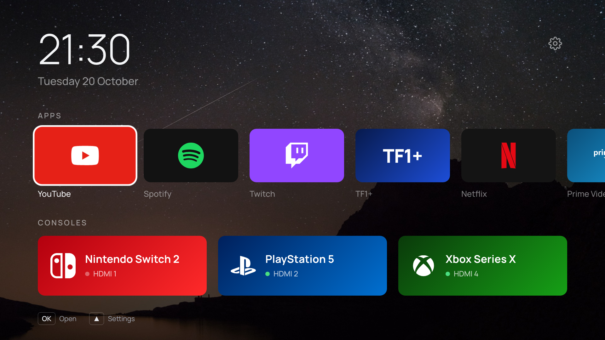

# Aivo Launcher

A quieter home screen for Samsung Tizen TVs: a clock, a row of your apps, an optional row of your
consoles, and nothing else. It installs as an ordinary app and is opened from the TV's app list.



*The browser preview, with the bundled Manrope font and the "Milky Way" wallpaper.*

Built for Samsung TVs from 2016 onward, and installed and running on a UE65RU7020 (2019,
Tizen 5.0). The package accepts Tizen 2.3 and up. The 2016 range (Tizen 2.4) runs a 2013-era
WebKit engine, so the launcher carries a small compatibility layer for it, tested against a model
of that engine; on 2017 and later TVs, which run Chromium, the layer switches itself off.

| | |
| --- | --- |
| Reference TV | UE65RU7020KXXU (RU7020, 2019), Tizen 5.0, armv7, web engine Chromium M63 |
| Install | Tizen SDK 10 CLI on macOS, Samsung certificate, `tizen install` over `sdb`: works |
| 2016 TVs (Tizen 2.4) | Supported by the compatibility layer; not yet run on real 2016 hardware |
| Original | Arn0 Launcher on a 2022 Q70B (Tizen 6.5, Chromium M85) |

Based on [Arn0 Launcher](https://github.com/NelsonEU/arn0-tv) by Arnaud Etienne (MIT).

## Quick start

Needs Node.js 20 or newer. No TV is involved until you install it.

```sh
cd ~/Projects/aivo-tv
npm install
npm test               # 77 checks, on a modern and a 2016 engine model
npm run preview        # http://localhost:8080
```

Navigate with the arrow keys and Enter; Esc or Backspace is Back; `R` `G` `Y` `B` are the remote's
colour keys. Stop the preview with Ctrl+C.

The preview runs against [`src/js/tizen-mock.js`](src/js/tizen-mock.js), a stand-in for the Tizen
APIs that is inert on the TV itself. Layout, focus, settings, fonts and wallpapers are real;
launching apps and switching HDMI inputs only do something on a TV.

## Put it on a TV

**[docs/setup-tv.md](docs/setup-tv.md)** walks through everything: Developer Mode on the TV,
Tizen Studio on a Mac, the Samsung certificate, signing and installing. It is reversible by
uninstalling the app.

[docs/compatibility-2016.md](docs/compatibility-2016.md) explains what was changed for the 2016
engine and what can only be confirmed on the TV.

## What you can change

Your own settings go in `src/js/config.local.js`. It is gitignored and merged over
[`src/js/config.js`](src/js/config.js) one level deep, so it reaches both the preview and the
packaged `.wgt` without ever being committed. Copy
[`config.local.example.js`](src/js/config.local.example.js) to start:

```js
window.LAUNCHER_LOCAL = {
    apps: [
        { match: 'netflix', label: 'Netflix', brand: 'netflix' },
        { id: 'AbCdEfGhIj.SomeApp', label: 'Some app' }    // exact id from "All apps"
    ],
    inputs: [ { hdmi: 1, label: 'PlayStation 5', brand: 'playstation' } ],   // [] for no row
    weather: { latitude: 51.51, longitude: -0.13 },
    locale: 'en-GB'
};
```

Most of it is also editable from the launcher's own Settings once it is on the TV, and the TV's
copy wins. Tile colours and brand marks live in [`src/js/brands.js`](src/js/brands.js), the look
in [`src/css/style.css`](src/css/style.css). After editing the stylesheet, run `npm run prefix`
to regenerate the `-webkit-` declarations the 2016 engine needs; `npm test` fails if you forget.

## Reference

### Commands

```sh
npm run preview      # browser preview on :8080
npm run deploy       # test, build, sign, install and open on the TV (docs/setup-tv.md, step 7)
npm run build        # -> dist/aivo-launcher.wgt (unsigned)
npm test             # syntax, legacy-engine lint, polyfills, the app on two engines, the package
npm run prefix       # regenerate the -webkit- declarations after editing css/style.css
npm run devlog       # receive Lab logs from the TV into logs/tv.jsonl
node scripts/prepare-wallpapers.mjs <folder>   # add your own photos as wallpapers (kept out of git)
python3 scripts/make-static-fonts.py           # only if a font or weight changes (needs fonttools)
```

### Remote

| Key | Action |
| --- | --- |
| Arrows | move (Up from the apps row reaches the gear = Settings) |
| OK | open app / switch input / select |
| Back | one level back (does nothing on Home) |

Colour-key shortcuts: Red = All apps, Green = next wallpaper, Yellow (in All apps) = show system
apps, Blue = Lab. If your remote has no colour buttons, its on-screen pad (**123**)
may offer them.
On Home, Left and Right alternating three times (◀ ▶ ◀ ▶ ◀ ▶) starts a hidden game.

### Layout

```
src/                  everything that goes into the .wgt
  config.xml          Tizen manifest (app id AivoLnchr0.Launcher, privileges, required_version 2.3)
  css/style.css       1920x1080 stage, written for the 2016 engine (see its header)
  fonts/static/       Manrope, Inter, Outfit, DM Sans as static WOFF (OFL)
  img/marks/          brand marks (Simple Icons CC0, Custom Brand Icons MIT; see SOURCES.md)
  img/tiles/          marks recoloured per brand (generated at build)
  img/wallpapers/     1920x1080 wallpapers with the readability scrim baked in
  js/compat.js        polyfills and helpers for the 2016 engine; loaded first
  js/config.js        default apps, consoles, HDMI method, locale, theme
  js/config.local.js  your overrides (gitignored)
  js/brands.js        tile colours and marks per brand
  js/apps.js          list / filter / launch via tizen.application
  js/inputs.js        HDMI via tizen.systeminfo + tizen.tvwindow
  js/wallpaper.js     wallpaper display and rotation
  js/screensaver.js   idle screen saver: photos, pan, clock, weather
  js/appearance.js    clock, date and font settings
  js/weather.js       Open-Meteo reading for the screen saver corner
  js/prefs.js         settings saved on the TV
  js/ui.js            screens, focus, keys, toast, pop-up menu
  js/home.js          Home, All apps, Lab
  js/settings.js      Settings pages
  js/devlog.js        development log (Lab screen, optional upload to your computer)
  js/render-probe.js  measures what this TV can render (Lab screen)
  js/platform-probe.js  reports which tizen.* / webapis.* APIs the TV exposes (Lab screen)
  js/boot.js          start-up
  js/tizen-mock.js    fake Tizen APIs for the browser preview (inactive on the TV)
scripts/              build, preview server, devlog server, CSS prefixing, font and asset tools
test/                 npm test; helpers/legacy-env.js models the 2016 engine
docs/                 setup guide and 2016 compatibility notes
```

### Your own wallpapers

Put photos in a folder (landscape works best; the file name becomes the title) and run:

```sh
node scripts/prepare-wallpapers.mjs ~/Pictures/tv-wallpapers
npm run deploy
```

They are cropped to 1920x1080 with the readability shading baked in, stripped of camera and
location metadata, and added after the bundled wallpapers in **Settings → Background**. They
live in `src/img/wallpapers/local/` and `src/js/wallpapers.local.js`, which are gitignored:
your photos go into your TV builds but never into the repository (`npm test` checks the ignore
rules are in place). Each run replaces the previous set with whatever is in the folder now.

### Settings

Saved on the TV in `localStorage`. They survive restarts and in-place updates, not an uninstall.

- **Background** — Off (plain gradient), one photo, or rotate: on each Home, 30 s, 5 min, 15 min,
  1 hour, daily.
- **Apps on Home** — OK on an app opens Move / Remove; OK on the right-hand slot adds one.
- **Consoles** — per console: rename, HDMI port, logo, how it opens, hide, reorder, remove; plus
  add a console.
- **Appearance** — 24/12-hour clock, date shown/hidden, date language (English, Español, Français),
  font, app names (always / when selected / never).
- **Navigation sound** — on or off, Soft, Warm or Bright, and a preview.
- **Screen saver** — on or off, start after 3/5/10/15 min idle on Home, photo change interval,
  go dark after 30 min / 1 hour / 2 hours / never, and show it now.
- **Samsung Home** — opens Samsung's own home screen (Smart Hub). The default id,
  `com.samsung.tv.csfs`, is from a 2022 TV; set `samsungHomeApp` in `config.local.js` if yours
  differs.
- **Advanced** — refresh the app list, export settings to the log, reset everything, Lab.

### Screen saver

After a few minutes with no input on Home it shows the wallpapers full screen with the clock, the
weather and the photo's name. Any button closes it. It never appears over a console input or
another screen. Everything in it moves slowly — the photo pans, the text shifts, the clock changes
corner — and it fades to black after the configured time, because a web app cannot switch the
panel off. Use the TV's own Eco Solution ▸ Auto Power Off for that.

The weather is off until you put coordinates in `config.local.js`. It comes from
[Open-Meteo](https://open-meteo.com/) (no API key), refreshes at most once an hour, and hides
rather than show a reading older than three hours.

### Apps

`getAppsInfo` reports many internal services as visible, so **All apps** keeps only ids that look
like store apps plus a few preinstalled consumer apps. Yellow shows everything. The id of the
focused app is shown bottom-left; pin it in `config.local.js` as `{ id: '...' }`, which is more
reliable than a name match.

### HDMI inputs

`tizen.systeminfo.getPropertyValue('VIDEOSOURCE')` lists the ports and `tizen.tvwindow.setSource()`
switches. Each console can open in one of two ways (Settings → Consoles):

- **TV input** (`switch+viewer`) — set the source, then open Samsung's TV viewer, so Game Mode works
  as usual. The viewer's app id, `org.tizen.tv-viewer`, may differ on older firmware.
- **Inside the launcher** (`inapp`) — show the input full screen in the launcher; Back returns.

The dot on each tile is green when the TV reports that port as connected.

### Performance

The Lab's **Render probe** measures what the TV can draw. On the original author's 2022 Q70B,
blurred shadows were free and large live gradients were ruinous (4.6 fps), so gradients are baked
into the wallpapers at build time. The 2019 RU7020 has an older engine (Chromium M63) and a
slower chip than that, and a 2016 TV slower still; run the probe on yours before adding effects.
Only `transform` and `opacity` animate.

### Privileges

| Privilege | Used for |
| --- | --- |
| `application.launch` | opening apps and the TV viewer |
| `application.info` | listing apps |
| `tv.inputdevice` | colour keys (arrows, OK and Back need no registration) |
| `tv.window` | HDMI source switching and display |
| `internet` + `<access origin="*">` | the Open-Meteo request and the development log |

## Licence and credits

MIT — see [LICENSE](LICENSE). Derived from
[Arn0 Launcher](https://github.com/NelsonEU/arn0-tv) © 2026 Arnaud Etienne, also MIT; that notice
is kept in LICENSE as the licence requires. Bundled fonts (OFL), Unsplash photos and brand marks
keep their own terms. Weather data by [Open-Meteo](https://open-meteo.com/), used under its
non-commercial licence. Brand names and logos belong to their owners.

This project is independent and is not affiliated with Samsung or any streaming service.
